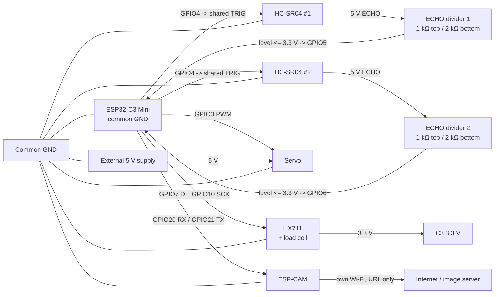

# SmartFeeder Connection Diagram

This document defines the wiring for the project's **ESP32-C3 DevKitM-1 /
ESP32-C3 Mini** and the sensors used by the current firmware.

> **Important:** verify the silkscreen on your board before wiring. This design
> uses GPIO numbers, which may not match the `D*` names printed on clone
> ESP32-C3 Mini boards.

## Pin map

| Function | Module signal | ESP32-C3 GPIO | Power |
| --- | --- | ---: | --- |
| Ultrasonic 1 and 2 | Shared `TRIG` | GPIO4 | — |
| Ultrasonic 1 | `ECHO` | GPIO5 | Divider to 3.3 V |
| Ultrasonic 2 | `ECHO` | GPIO6 | Divider to 3.3 V |
| Load cell | HX711 `DT/DOUT` | GPIO7 | 3.3 V |
| Load cell | HX711 `SCK` | GPIO10 | 3.3 V |
| Servo | PWM signal | GPIO3 | External 5 V servo supply |
| ESP-CAM | C3 UART `RX` | GPIO20 (`UART1_RX`) | 3.3 V logic |
| ESP-CAM | C3 UART `TX` | GPIO21 (`UART1_TX`) | 3.3 V logic |

The UART connection is crossed: ESP-CAM `TX` goes to C3 `RX`, and ESP-CAM
`RX` goes to C3 `TX`. The UART transports control data only, such as an image
or stream URL; video does not pass through the ESP32-C3. The ESP-CAM connects
to the Internet through its own Wi-Fi, while the C3 keeps its existing
backend Wi-Fi connection.

## Diagram



## Detailed wiring

### HC-SR04

Both modules share only `TRIG`; each keeps its own `ECHO`. Do not read both
ECHO signals at the same time. The firmware should trigger GPIO4 and then
measure GPIO5 or GPIO6 separately to avoid interference.

Conventional HC-SR04 modules operate at 5 V and may output 5 V on `ECHO`.
Use one divider for each ECHO:

```text
HC-SR04 ECHO --- 1 kΩ ---+--- ESP32-C3 GPIO
                         |
                        2 kΩ
                         |
                        GND
```

With a 5 V ECHO signal, the midpoint is approximately:

```text
Vout = 5 V × 2 kΩ / (1 kΩ + 2 kΩ) = 3.33 V
```

This is usable for an ESP32-C3 input, but it is close to the upper limit. If
the HC-SR04 supply is higher than 5 V, preferably use `1 kΩ` on top and
`1.8 kΩ` on the bottom, producing approximately 3.21 V.

**Do not swap the resistors:** `2 kΩ` on top and `1 kΩ` on the bottom produces
approximately 1.67 V, which may not be recognized as a logic-high level by
the ESP32-C3. Never connect `ECHO` directly to the ESP32-C3. Keep the two
sensor cables separated and avoid pointing both transducers directly at each
other.

The firmware identifies GPIO5 as the plate-level sensor and GPIO6 as the
pet-presence sensor. It measures them sequentially every second and includes
valid readings in telemetry:

| Backend field | Source | Meaning |
| --- | --- | --- |
| `hopperDistanceMm` | GPIO5 | Distance inside the food deposit, valid up to 200 mm |
| `hopperFoodPercent` | GPIO5 | Estimated deposit fill: `106 mm = 0%`, `0 mm = 100%`; farther readings are 0% |
| `petDistanceMm` | GPIO6 | Distance from the presence sensor |
| `petPresent` | GPIO6 | `true` when distance is at most 100 mm |

The 100 mm presence threshold is a firmware constant and should be adjusted
after testing the sensor's physical position.

When the pet is detected in two consecutive valid readings, telemetry includes
`petEvent: "detected"`. Invalid ultrasonic readings do not count as absence.
After 20 seconds without a valid detection plus five confirmed absence readings,
the firmware waits for the HX711 to settle without blocking the main loop and
includes `petEvent: "left"`. the backend uses the HX711 plate weight before and after that session to
calculate and persist consumption on the corresponding feeding event. It can notify the frontend with
alerts for full, partial, or untouched food, and it skips a later dispense
command when more than 2 g remain on the plate.

### HX711 and load cell

Connect HX711 `VCC` to 3.3 V, `GND` to GND, `DT/DOUT` to GPIO7, and `SCK` to
GPIO10. Connect the load cell according to the manufacturer's wiring for the
specific HX711 board. Do not interchange `A+`, `A-`, `E+`, and `E-` without
recalibrating.

The firmware uses `1.0` only when no calibration has been saved. It restores
the calibration factor and tare offset from non-volatile memory, then prints
the raw value and calculated weight every second at 115200 baud. The servo
remains attached after movement so the existing dispensing behavior is not
changed.

### HX711 calibration procedure

1. Upload the firmware and open the serial monitor at 115200 baud.
2. With the load cell completely empty, send `hx711 tare`.
3. Put a known weight on the platform, for example 100 g, and wait for the
   reading to stabilize.
4. Send `hx711 calibrate 100` (replace `100` with the exact weight in grams).
5. Send `hx711 read` to verify the result. The factor and tare offset are
   stored in non-volatile memory and restored after reboot.

The sign of the factor depends on the load-cell wiring. If the measured value
is negative, keep the same sign in the calculated factor. The commands
`hx711 status`, `hx711 raw`, `hx711 read`, and `hx711 tare` can be used at any
time for debugging. Automatic weight readings use nine samples, discard the two
highest and two lowest values, and average the remaining five.

### Servo

GPIO3 provides only the PWM signal. Power the servo from an external 5 V
supply capable of handling its startup current; do not power it from the
C3's 3.3 V regulator. Connect the servo supply GND to ESP32-C3 GND. A
470–1000 µF capacitor between 5 V and GND near the servo is recommended.

The firmware performs a startup position test: it moves to 0°, 90°, and 180°
with a two-second pause at each position, then stops at 180°. Open the serial
monitor at 115200 baud and send one of these newline-terminated commands to
set a position manually:

```text
0
90
180
test
```

Use the angles only as calibration references. The actual dispensing and
non-dispensing angles should be selected after checking the mechanical
linkage, and the servo must not be forced against its end stops.

When a backend `dispense` command is received, the firmware records the
current plate weight, marks the command as `processing`, and alternates the
servo between `0°` and `180°`. Each transition transfers the next portion
while the other compartment refills. The HX711 is read between movements and
the command is marked `completed` when the plate weight has increased by the
requested grams. A 60-second timeout marks the command as `failed` if the
requested weight is not reached.

### ESP-CAM UART

| ESP32-C3 | ESP-CAM |
| --- | --- |
| GPIO20 (`RX`) | `TX` |
| GPIO21 (`TX`) | `RX` |
| GND | GND |

Use 3.3 V signals only. Never connect 5 V to a GPIO. The ESP-CAM needs its own
stable supply, normally 5 V with local 3.3 V regulation; check the exact
module model before powering it.

A simple initial protocol can use newline-terminated messages:

```text
IMG_URL=http://server.local/cam/latest.jpg
STREAM_URL=http://server.local/cam/stream
```

The C3 can store or forward these strings to the backend, but it must not try
to forward video bytes over its UART.

## Power and commissioning rules

1. Connect all grounds: C3, HC-SR04 modules, HX711, servo, and ESP-CAM.
2. Use an external supply for the servo and preferably a separate stable
   supply branch for the ESP-CAM; the C3 USB supply should not power motors.
3. Before connecting signal wires, measure that no GPIO receives more than
   3.3 V.
4. Test in this order: HX711, each HC-SR04 separately, servo, and finally the
   ESP-CAM UART.
5. GPIO20/21 are reserved for the ESP-CAM UART in the next firmware stage;
   do not reuse them for sensors.
